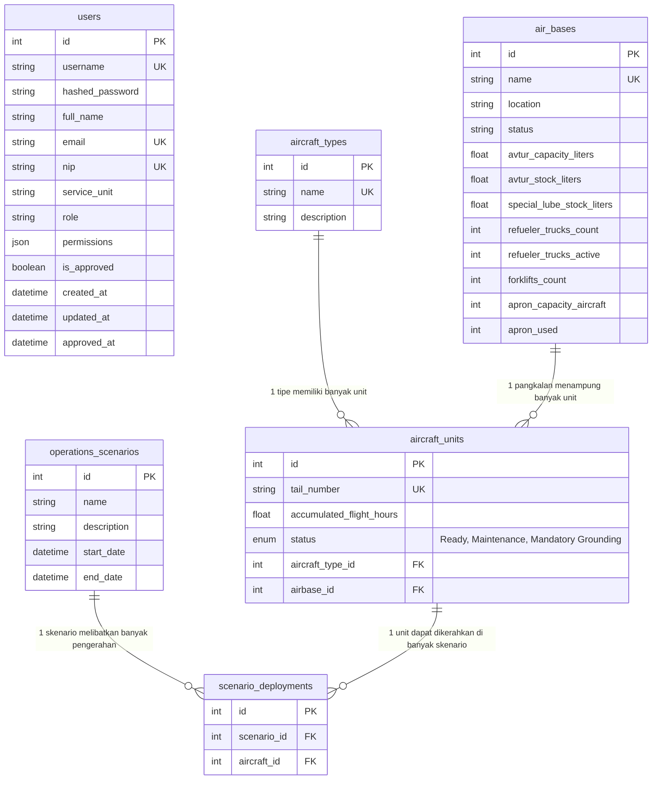

# 📊 Entity Relationship Diagram (ERD) — Aplikasi SIMKO TNI AU

Dokumen ini berisi struktur relasi antartabel database MySQL untuk **Aplikasi SIMKO (Sistem Informasi Manajemen Kekuatan Operasi Udara TNI AU)**.

---

## 🎨 Diagram ERD (Mermaid Visual)

---

## 📋 Detail Struktur Tabel & Kolom

### 1. `users` (Pengguna & Akses RBAC)
Menyimpan akun pengguna sistem SIMKO dengan kontrol akses berbasis peran (*Role-Based Access Control*).

| Nama Kolom | Tipe Data | Keterangan | Constraint |
| :--- | :--- | :--- | :--- |
| `id` | `INT` | Primary Key | `PK`, Auto-increment |
| `username` | `VARCHAR(100)` | Username login | `UNIQUE`, `NOT NULL`, Indexed |
| `hashed_password` | `VARCHAR(255)` | Password terenkripsi | `NOT NULL` |
| `full_name` | `VARCHAR(150)` | Nama lengkap personel | `NOT NULL` |
| `email` | `VARCHAR(255)` | Alamat email | `UNIQUE`, Nullable |
| `nip` | `VARCHAR(50)` | NIP / NRP Personel TNI AU | `UNIQUE`, `NOT NULL`, Indexed |
| `service_unit` | `VARCHAR(100)` | Satuan kerja / Kesatuan | `NOT NULL` |
| `role` | `VARCHAR(50)` | Peran (*Administrator*, *Analyst*, *Executive*) | `NOT NULL`, Default: `'Analyst'` |
| `permissions` | `JSON` | Hak akses tambahan per fitur | Nullable |
| `is_approved` | `BOOLEAN` | Status persetujuan akun admin | `NOT NULL`, Default: `False` |
| `created_at` | `DATETIME` | Waktu pendaftaran | `NOT NULL`, Server default NOW |
| `updated_at` | `DATETIME` | Waktu update terakhir | `NOT NULL`, Server default NOW |
| `approved_at` | `DATETIME` | Waktu akun disetujui | Nullable |

---

### 2. `aircraft_types` (Jenis / Tipe Pesawat)
Master data jenis armada udara (misal: F-16, C-130 Hercules, Sukhoi Su-30).

| Nama Kolom | Tipe Data | Keterangan | Constraint |
| :--- | :--- | :--- | :--- |
| `id` | `INT` | Primary Key | `PK`, Auto-increment |
| `name` | `VARCHAR(255)` | Nama tipe pesawat | `UNIQUE`, `NOT NULL`, Indexed |
| `description` | `VARCHAR(255)` | Deskripsi/spesifikasi | Nullable |

---

### 3. `air_bases` (Pangkalan Udara / Lanud)
Data pangkalan udara beserta infrastruktur dan logistik operasional.

| Nama Kolom | Tipe Data | Keterangan | Constraint |
| :--- | :--- | :--- | :--- |
| `id` | `INT` | Primary Key | `PK`, Auto-increment |
| `name` | `VARCHAR(255)` | Nama Lanud | `UNIQUE`, `NOT NULL`, Indexed |
| `location` | `VARCHAR(255)` | Lokasi / Wilayah | Nullable |
| `status` | `VARCHAR(50)` | Status pangkalan (*optimal*, *warning*, *critical*) | Default: `'optimal'` |
| `avtur_capacity_liters` | `FLOAT` | Kapasitas tangki Avtur (Liter) | Default: `0.0` |
| `avtur_stock_liters` | `FLOAT` | Stok Avtur tersedia (Liter) | Default: `0.0` |
| `special_lube_stock_liters`| `FLOAT` | Stok pelumas khusus (Liter) | Default: `0.0` |
| `refueler_trucks_count` | `INT` | Total truk pengisi bahan bakar | Default: `0` |
| `refueler_trucks_active` | `INT` | Truk refueler yang aktif | Default: `0` |
| `forklifts_count` | `INT` | Total forklift / alat berat | Default: `0` |
| `apron_capacity_aircraft` | `INT` | Kapasitas parkir apron (unit) | Default: `0` |
| `apron_used` | `INT` | Apron yang sedang terpakai | Default: `0` |

---

### 4. `aircraft_units` (Unit Armada Pesawat / Tail Number)
Data unit individual pesawat udara yang siap atau sedang bertugas.

| Nama Kolom | Tipe Data | Keterangan | Constraint |
| :--- | :--- | :--- | :--- |
| `id` | `INT` | Primary Key | `PK`, Auto-increment |
| `tail_number` | `VARCHAR(255)` | Nomor ekor / registrasi (misal: TS-1601) | `UNIQUE`, `NOT NULL`, Indexed |
| `accumulated_flight_hours`| `FLOAT` | Akumulasi jam terbang | Default: `0.0` |
| `status` | `ENUM` | Status kesiapan (`Ready`, `Maintenance`, `Mandatory Grounding`) | `NOT NULL`, Default: `'Ready'` |
| `aircraft_type_id` | `INT` | Foreign Key ke `aircraft_types` | `FK`, `aircraft_types.id` |
| `airbase_id` | `INT` | Foreign Key ke `air_bases` | `FK`, `air_bases.id`, Nullable |

---

### 5. `operations_scenarios` (Skenario Operasi)
Data rencana skenario pengerahan operasi udara militer.

| Nama Kolom | Tipe Data | Keterangan | Constraint |
| :--- | :--- | :--- | :--- |
| `id` | `INT` | Primary Key | `PK`, Auto-increment |
| `name` | `VARCHAR(255)` | Nama skenario operasi | `NOT NULL`, Indexed |
| `description` | `VARCHAR(255)` | Deskripsi rencana operasi | Nullable |
| `start_date` | `DATETIME` | Waktu mulai operasi | Default: UTC Now |
| `end_date` | `DATETIME` | Waktu selesai operasi | Nullable |

---

### 6. `scenario_deployments` (Pivot Pengerahan Pesawat)
Tabel penghubung pengerahan unit pesawat pada skenario operasi tertentu (*Many-to-Many*).

| Nama Kolom | Tipe Data | Keterangan | Constraint |
| :--- | :--- | :--- | :--- |
| `id` | `INT` | Primary Key | `PK`, Auto-increment |
| `scenario_id` | `INT` | Foreign Key ke `operations_scenarios` | `FK`, `operations_scenarios.id`, `NOT NULL` |
| `aircraft_id` | `INT` | Foreign Key ke `aircraft_units` | `FK`, `aircraft_units.id`, `NOT NULL` |

---

## 🔗 Ringkasan Hubungan Antartabel

> [!NOTE]
> 1. **`aircraft_types` $\rightarrow$ `aircraft_units` (`1 : N`)**: Setiap tipe pesawat memiliki 1 atau banyak unit *tail number*.
> 2. **`air_bases` $\rightarrow$ `aircraft_units` (`1 : N`)**: Setiap pangkalan udara menjadi *homebase* penempatan untuk 1 atau banyak unit pesawat.
> 3. **`operations_scenarios` $\leftrightarrow$ `aircraft_units` (`N : M`)**: Dihubungkan secara presisi melalui tabel perantara **`scenario_deployments`**.
> 4. **`users`**: Berdiri mandiri untuk mengelola otentikasi login, hak akses RBAC (*Analyst*, *Executive*, *Administrator*), dan persetujuan akun.
