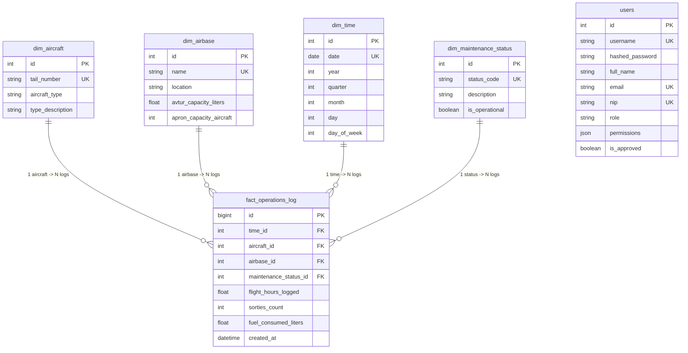
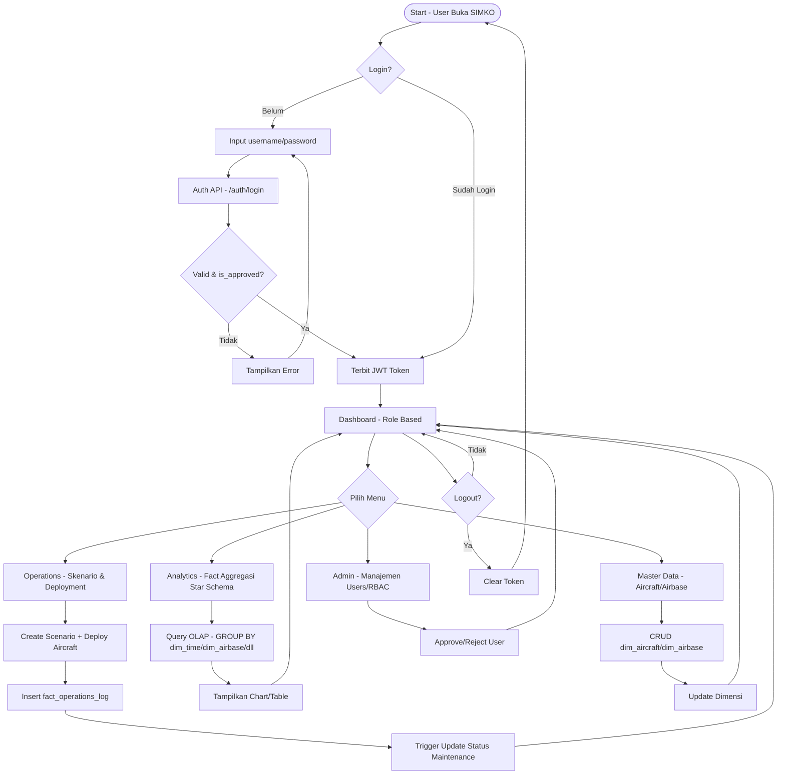

# Desain Star Schema - SIMKO Probe Ops MABES AU

## 1. Struktur Basis Data Star Schema

Pusat: `fact_operations_log`. Mengelilingi: 4 dimensi + 1 tabel keamanan.

| Tabel | Jenis | Fungsi |
|---|---|---|
| `dim_aircraft` | Dimensi | Master pesawat (tail_number, type) |
| `dim_airbase` | Dimensi | Master pangkalan udara |
| `dim_time` | Dimensi | Waktu (date, year, quarter, month, day) |
| `dim_maintenance_status` | Dimensi | Status kelaikan (Ready, Maintenance, Grounding) |
| `fact_operations_log` | Fakta | Log operasional (FK ke 4 dimensi + measures: flight_hours, sorties, fuel) |
| `users` | Keamanan | Akun + RBAC (terpisah OLTP, tidak join ke fact) |

## 2. DDL Script Lokal

File: `backend/backend/migrations/star_schema_setup.sql`

Jalankan lokal:
```bash
mysql -u root -p probe_ops < backend/backend/migrations/star_schema_setup.sql
# atau SQLite untuk simulasi:
# sqlite3 probe_ops.db < backend/backend/migrations/star_schema_setup.sql
```

Isi DDL: `dim_time`, `dim_maintenance_status`, `dim_aircraft`, `dim_airbase`, `users`, `fact_operations_log` + FK ke dimensi, engine InnoDB utf8mb4.

## 3. ERD Star Schema (Mermaid)



> Catatan: `users` sengaja tidak berelasi ke fact (keamanan OLTP). Jika butuh audit, tambah `created_by` FK ke `users.id` di fact.

## 4. Flowchart Alur Sistem Keseluruhan



## 5. Diagram Konteks (Level 0 DFD)

```mermaid
flowchart LR
    subgraph Eksternal
        A1[Analyst - Staf Ops]
        A2[Executive - Pimpinan]
        A3[Administrator]
        A4[Sistem Cuaca BMKG API]
    end

    subgraph SIMKO["SIMKO Probe Ops System"]
        P1((1.0 Auth & RBAC - users))
        P2((2.0 Master Data - dim_*))
        P3((3.0 Operasi Log - fact_operations_log))
        P4((4.0 Analytics OLAP))
    end

    DB[(MySQL - Star Schema)]

    A1 -- "Login, Input Log Operasi, Lihat Dashboard" --> P1
    A1 --> P3
    P1 --> A1
    P3 --> DB
    DB --> P4
    P4 --> A1
    P4 --> A2

    A2 -- "Login, Lihat Laporan Executive" --> P1
    A2 --> P4

    A3 -- "Kelola User, Approve, Master Data" --> P1
    A3 --> P2
    P2 --> DB
    DB --> P2
    P2 --> A3

    A4 -- "Data Cuaca JSON" --> P3

    P1 -. "validasi" .-> DB
    P1 -. "JWT" .-> A1 & A2 & A3
```



## 6. Verifikasi Lokal

```bash
# cek sintaks SQLite (simulasi cepat)
sqlite3 :memory: < backend/backend/migrations/star_schema_setup.sql && echo OK
```
MySQL asli: jalankan file `star_schema_setup.sql` via Workbench / CLI. Semua FK cascade/restrict sesuai desain OLAP.
